### Programador Júnior @ CIMENTPAV
**Desenvolvimento web · PHP & Laravel · JavaScript & React**

*Da investigação de bugs à construção de soluções.*

## `01` · Olá, eu sou o Lucas

Sou **Programador Júnior na CIMENTPAV** e estudante de **Análise e Desenvolvimento de Sistemas na Fatec Itapetininga**, com conclusão prevista para dezembro de 2026.

Meu foco atual é o **desenvolvimento web**, com PHP, Laravel, JavaScript, React e bancos de dados. Minha trajetória também passa por automação de processos, suporte técnico e **9 meses de experiência em QA na Sonoda Ponto**.

Levo essa experiência em qualidade para o código: atenção às regras de negócio, às permissões, aos cenários de erro e à experiência de quem usa o sistema.

## `02` · Tecnologias e foco atual

| Frente | Meu foco |
| :--- | :--- |
| **Back-end** | PHP, Laravel, APIs REST e regras de negócio |
| **Front-end** | JavaScript, React, HTML, CSS e usabilidade |
| **Dados** | MySQL, PostgreSQL e SQL |
| **Automação** | Python para simplificar tarefas e processos |
| **Qualidade** | Testes manuais e funcionais, Cypress, Playwright, Postman e Insomnia |

## `03` · Minha trajetória

### CIMENTPAV · Programador Júnior
**Atuação atual · Desenvolvimento web**

Nova etapa profissional com foco em programação, integração de sistemas e bancos de dados. Aprofundando a prática com **PHP, Laravel, JavaScript e React**, junto à experiência em qualidade de software.

### Sonoda Ponto · Estagiário de garantia de qualidade de software
**Janeiro a setembro de 2026 · Itapetininga, São Paulo**

- Testes manuais, funcionais e exploratórios em aplicações **Web, PWA, Mobile e APIs REST**.
- Validação de regras de negócio, permissões e configurações **multitenant** em sistemas de transporte de pacientes, limpeza hospitalar, estoque e help desk.
- Investigação, documentação e acompanhamento de bugs, com validação das correções junto ao desenvolvimento.
- Verificações de responsividade, compatibilidade entre navegadores e sincronização online/offline.
- Aplicação de conhecimentos de **UI/UX** na avaliação de interfaces e fluxos.

### Prefeitura de Itapetininga · Estagiário de TI
**Abril de 2025 a janeiro de 2026 · Itapetininga, São Paulo**

- Automação de planilhas com **Python**.
- Participação no desenvolvimento de **APIs e interfaces front-end**.
- Integração de APIs para apoiar a divulgação de encontros do Sebrae.
- Suporte técnico aos setores administrativos e manutenção de computadores e impressoras.

## `04` · Projetos e estudos

| Repositório | O que você encontra |
| :--- | :--- |
| [Estudos de APIs ↗](https://github.com/Lucas-Elias/Curso_Api--Learning-about-APIs) | Aprendizado e prática de APIs |
| [Programação web ↗](https://github.com/Lucas-Elias/Exercicios-Prog-web1) | Exercícios das aulas de programação web |
| [Estudos de Java ↗](https://github.com/Lucas-Elias/dio-basic-java) | Fundamentos e exercícios de Java |

**Zenit · Projeto acadêmico**

Participei da apresentação do **Zenit no 18º MIT da Fatec Itapetininga**, com uma proposta ligada aos ODS 2030: tornar a web mais amigável e segura para pessoas neurodivergentes e para o público em geral. A ideia envolve filtros de estímulos, apoio ao controle do tempo online e autonomia no consumo de conteúdo.

[Repositório do protótipo ↗](https://github.com/Lucas-Elias/Zenit-Prototipo) · [Publicação no LinkedIn ↗](https://www.linkedin.com/feed/update/urn:li:activity:7340434042191822848/)

## `05` · Formação

**Fatec Itapetininga · Tecnologia em Análise e Desenvolvimento de Sistemas**  
Fevereiro de 2024 a dezembro de 2026 · Em andamento

**Curso de UI/UX** · Conhecimentos aplicados à avaliação de interfaces, navegação e experiência dos usuários.

**Inglês intermediário** · [Certificado Voxy, emitido em janeiro de 2026 ↗](https://app.voxy.com/certificates/proficiency-test/69664e67fc967f3ca2a1c22a)

## `06` · Histórico de contribuições

<picture>
  <source media="(prefers-color-scheme: dark)" srcset="https://raw.githubusercontent.com/Lucas-Elias/Lucas-Elias/output/github-snake-dark.svg" />
  <source media="(prefers-color-scheme: light)" srcset="https://raw.githubusercontent.com/Lucas-Elias/Lucas-Elias/output/github-snake.svg" />
  
</picture>

---

**Vamos conversar sobre desenvolvimento e qualidade de software?**

[Me encontre no LinkedIn ↗](https://www.linkedin.com/in/lucascampos-qa/)

